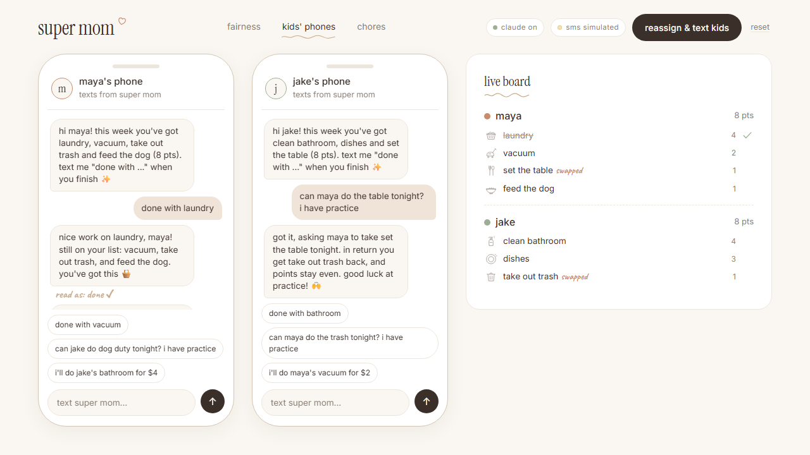
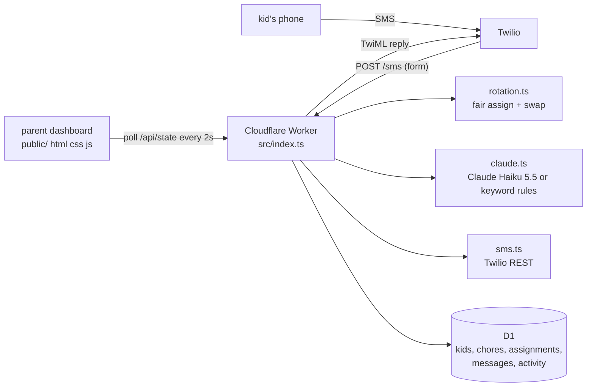

# super mom ♡

**a fair chore tracker that texts kids their chores and uses claude to read their replies.**

super mom splits the week's chores fairly by effort, texts each kid their list, and understands what they text back ("done with laundry", "can maya do the table? i have practice"). parents stop being the household's project manager, and siblings stop arguing about whose turn it is.

**live demo:** https://supermom.kyliemarcisz.workers.dev



> growing up, my parents and I fought constantly about whose turn it was to do the dishes. super mom is the referee we never had.

Built at the Code for Women AI hackathon for two tracks: **women's economic mobility** and **education and opportunity**.

## the problem

- **Moms carry the mental load.** In a 2024 study of 3,000 US parents, mothers were mostly responsible for **71%** of household mental-load tasks, compared with **45%** for fathers. ([University of Bath / Journal of Marriage and Family](https://www.bath.ac.uk/announcements/mothers-bear-the-brunt-of-the-mental-load-managing-7-in-10-household-tasks/))
- **The gap starts young.** UNICEF found that girls aged 5 to 9 do **30% more** chores than boys, and the gap rises to **50%** for ages 10 to 14. ([UNICEF](https://www.unicef.org/press-releases/girls-spend-160-million-more-hours-boys-doing-household-chores-everyday))

The planning, assigning and reminding is invisible work, and it usually lands on mom. When chores are handed out by whoever says yes first, the work drifts toward girls.

## track fit

- **Women's economic mobility:** super mom takes the planning and nagging off mothers, so unpaid work at home stops eating into their time and careers.
- **Education and opportunity:** it makes the sibling chore gap visible and closes it, so girls get the same time to study and play as their brothers.

## features

| feature | what it does |
|---|---|
| fair rotation | every chore has effort points (dishes 3, laundry 4, clean bathroom 4, vacuum 2, trash 1, feed the dog 1, set the table 1). the hardest chores go out first, each to the kid with the fewest points. ties go to whoever did less last week. |
| one-tap texts | **assign & text kids** sends each kid their list by SMS (Twilio) or to the simulated phones. |
| claude reads replies | each text is classified as `done`, `swap`, `excuse` or `question`. claude returns JSON `{intent, chore, to, reply}` and the server checks it against real state before updating anything. replies are warm, lowercase, under 35 words, and never use em dashes. |
| fair swaps | "can maya do the table?" moves the chore to the sibling, who hands back their unfinished chore closest in points, so totals stay even. the sibling gets a heads-up text. |
| chore bids | kids can trade chores for money. "i'll do jake's dishes for $3" or "i'll pay maya $4 to do my bathroom" texts the sibling, who replies "deal" or "no thanks". the chore and its points move to whoever does the work, and the dashboard shows what each kid earned and paid, so extra work is chosen and paid, never assumed. |
| fairness dashboard | points per kid, sibling gap, chores done and parent reminders, with a before/after toggle. |
| simulated phones | two phones with chat bubbles and quick-reply chips, so the demo works without real SMS. |
| demo mode | no `ANTHROPIC_API_KEY`: keyword rules read the texts. no Twilio credentials: texts go to the simulated phones only. badges show `claude on / demo` and `sms live / simulated`. |
| easy to change | kids, phones and chores live in D1 (`migrations/0002_seed.sql`). |

The **"before"** view is an **illustrative baseline**, not measured data: Maya 11 points and Jake 5 points (69% vs 31%), 14 parent reminders, 9 of 16 tasks done.

## architecture



- `src/index.ts`: router and the glue between the modules
- `src/rotation.ts`: pure functions for fair assignment and fair swaps
- `src/claude.ts`: prompt, JSON schema, parsing, reply cleanup, keyword fallback
- `src/sms.ts`: Twilio send, TwiML, signature check
- `src/db.ts`: every D1 query

**routes:** `GET /api/state`, `POST /api/assign`, `POST /api/message {kid, text}`, `POST /api/reset`, `POST /sms` (Twilio webhook)

**dependencies:** wrangler, typescript and vitest. Claude and Twilio are called with `fetch`.

## setup

### run locally

```bash
npm install
npm run db:local          # create + seed the local D1 database
cp .dev.vars.example .dev.vars   # optional: add keys, blank = demo mode
npx wrangler dev          # http://localhost:8787
npm test                  # 34 vitest tests
```

### deploy to Cloudflare

```bash
npx wrangler login
npx wrangler d1 create supermom          # paste the database_id into wrangler.jsonc
npm run db:remote                        # apply migrations + seed
npx wrangler deploy                      # https://supermom.<you>.workers.dev
```

### secrets (all optional)

```bash
npx wrangler secret put ANTHROPIC_API_KEY     # claude on
npx wrangler secret put TWILIO_ACCOUNT_SID    # sms live (needs all three)
npx wrangler secret put TWILIO_AUTH_TOKEN
npx wrangler secret put TWILIO_FROM           # your Twilio number, e.g. +15551234567
npx wrangler secret put PHONE_MAYA            # kid phones, override the kids table
npx wrangler secret put PHONE_JAKE
```

`CLAUDE_MODEL` defaults to `claude-haiku-5-5` and can be changed in `wrangler.jsonc`.

### Twilio webhook

In the Twilio console, open **Phone Numbers > your number > Messaging**, set **"A message comes in"** to a webhook, and enter:

```
https://<worker>.workers.dev/sms   (HTTP POST)
```

The worker checks `X-Twilio-Signature` whenever `TWILIO_AUTH_TOKEN` is set. Trial accounts can only text verified numbers, and US numbers need A2P 10DLC or toll-free verification before carriers deliver texts reliably.

### auto-deploy from GitHub (Workers Builds)

1. Cloudflare dashboard > **Workers & Pages** > **supermom** > **Settings** > **Builds** > **Connect**.
2. Pick GitHub and this repo (`kyliemarcisz/supermom`), with branch `main`.
3. Build command: `npm ci`. Deploy command: `npx wrangler deploy`.
4. Save. Every push to `main` now deploys. Run `npm run db:remote` yourself when you add a migration.

## 2-minute demo script

1. **Hook:** "growing up, my parents and I fought constantly about whose turn it was to do the dishes."
2. **Toggle "before":** Maya did 69% of the work, and the parent sent 14 reminders.
3. **Click "assign & text kids":** an even 8/8 split, and both kids get a text.
4. **Kids' phones:** Maya taps "done with laundry". Jake taps "can maya do the table tonight? i have practice". Claude handles both, Maya gets a heads-up, and the swap stays fair (Jake takes the trash back).
5. **Back to fairness:** a 50/50 split and 0 reminders.
6. **Close:** "super mom gives moms their time back and teaches the next generation that chores aren't a girl's job."

Tap **reset** to run it again.

## what's next

- parent onboarding: add your own kids, chores and point values in the app
- weekly rotation that carries last week's points forward automatically
- durable weekly workflows on [Temporal Cloud](https://temporal.io/cloud): rotate chores every Sunday, wait for each kid's "done", and send one gentle nudge only if a chore is still open the next evening, surviving restarts without losing a timer
- age-aware chores and allowance or reward tracking
- reminders the kids schedule themselves ("text me at 7")
- Spanish and other languages for the texts
- a co-parent view, so both parents see the same board

## license

MIT. See [LICENSE](LICENSE).
